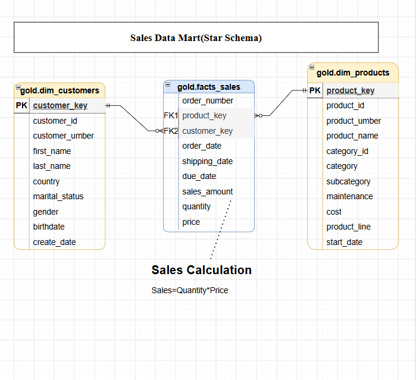

# 🏗️ Modern SQL Server Data Warehouse
### End-to-End Data Engineering | ETL Pipelines | Medallion Architecture | Dimensional Modelling

<p align="center">
  <strong>Transforming raw CRM and ERP data into a structured, integrated, and analytics-ready data warehouse.</strong>
</p>

---

## 📌 Project Overview

This project focuses on designing and implementing a modern **SQL Server Data Warehouse** that consolidates data from two operational source systems: Customer Relationship Management (CRM) and Enterprise Resource Planning (ERP).

The solution follows the **Medallion Architecture**, organizing data into three logical layers: Bronze, Silver, and Gold. Each layer serves a distinct purpose, from raw data ingestion to cleansing, transformation, integration, and analytical modelling.

The final warehouse provides a unified view of customer, product, and sales information through a dimensional data model designed to support business intelligence and analytical reporting.

The project demonstrates practical applications of SQL-based data engineering, ETL development, data quality management, and dimensional modelling.

## 🎯 Project Objectives

- Integrate data from multiple CRM and ERP source systems.
- Design a structured data warehouse using Microsoft SQL Server.
- Implement a layered ETL architecture using Bronze, Silver, and Gold.
- Identify and resolve data quality issues during transformation.
- Integrate customer, product, and sales information across source systems.
- Develop business-oriented fact and dimension views.
- Document the warehouse architecture, data models, and naming conventions.

---

## 🏛️ Data Warehouse Architecture

The solution uses a three-layer Medallion Architecture.

### 🥉 Bronze Layer — Raw Data Ingestion

The Bronze Layer stores source data from CRM and ERP CSV files with minimal transformation.

**Key operations:**
- Ingest source files using SQL Server `BULK INSERT`.
- Load data into source-aligned relational tables.
- Preserve the original source structure.
- Use truncation and reload procedures for batch ingestion.

**Source systems:**
- CRM: Customer, product, and sales information.
- ERP: Customer demographics, customer locations, and product categories.

### 🥈 Silver Layer — Data Cleansing & Transformation

The Silver Layer applies data quality rules and standardizes source data to prepare it for integration.

**Key operations:**
- Remove duplicate customer records.
- Standardize customer names and categorical attributes.
- Handle missing and invalid values.
- Normalize product identifiers and categories.
- Convert date fields into appropriate SQL data types.
- Validate sales amounts, quantities, and prices.
- Integrate and prepare source attributes for downstream modelling.

### 🥇 Gold Layer — Business-Level Data Modelling

The Gold Layer provides a business-oriented data model through dimension and fact views.

**Implemented analytical objects:**

| Object | Description |
|---|---|
| `gold.dim_customers` | Integrated customer information, including demographic and geographic attributes |
| `gold.dim_products` | Product details enriched with category and product attributes |
| `gold.fact_sales` | Sales transactions connected to customer and product dimensions |

The Gold Layer follows a dimensional modelling approach, making the data easier to understand and query for analytical workloads.

---

## 🔄 Data Flow & Integration

### 1. Overall Data Flow


### 2. CRM and ERP Data Integration


### 3. Data Model



---

## 🧰 Technology Stack

| Area | Technologies |
|---|---|
| Database Platform | Microsoft SQL Server |
| Query Language | T-SQL |
| Data Ingestion | SQL Server BULK INSERT |
| ETL Development | T-SQL Stored Procedures |
| Data Architecture | Medallion Architecture |
| Data Modelling | Fact and Dimension Modelling |
| Data Quality | SQL Validation Queries |
| Source Data | CSV Files |
| Version Control | Git and GitHub |
| Documentation | Markdown and Architecture Diagrams |

---

## 📂 Repository Structure

```text
sql-data-warehouse-project/
│
├── datasets/
│   ├── souce_erm/
│   │   ├── cust_info.csv
│   │   ├── prd_info.csv
│   │   └── sales_details.csv
│   │
│   └── source_erp/
│       ├── CUST_AZ12.csv
│       ├── LOC_A101.csv
│       └── PX_CAT_G1V2.csv
│
├── documents/
│   ├── CRM and ERP Data Integration Flow.png
│   ├── Modern Data Flow Warehouse Diagram.png
│   ├── data_architecture (2).png
│   ├── data_model.png
│   ├── Project_Requirements.pdf
│   ├── data_catalog.md
│   ├── naming_conventions.md
│   └── requirements.md
│
├── scripts/
│   ├── bronze/
│   │   ├── ddl_bronze.sql
│   │   └── proc_load_bronze.sql
│   │
│   ├── silver/
│   │   ├── ddl_silvver.sql
│   │   ├── inti_database.sql
│   │   └── proc_load_silver.sql
│   │
│   └── gold/
│       └── ddl_gold.sql
│
├── tests/
│   ├── quality_check_silver.sql
│   └── quality_checks_gold.sql
│
└── LICENSE
```

---

## ⚙️ Implementation & Execution

### Prerequisites

- Microsoft SQL Server.
- SQL Server Management Studio (SSMS).
- Access to the project source CSV files.
- Appropriate SQL Server permissions to create databases, schemas, tables, and stored procedures.
- Permissions for SQL Server to access the source CSV files when using `BULK INSERT`.

### Step 1 — Create the Database

Execute:

```text
scripts/silver/inti_database.sql
```

This script creates the `DataWarehouse` database and the Bronze, Silver, and Gold schemas.

### Step 2 — Create Bronze Tables

Execute:

```text
scripts/bronze/ddl_bronze.sql
```

This creates the raw ingestion tables for the CRM and ERP datasets.

### Step 3 — Load Bronze Data

Execute:

```text
scripts/bronze/proc_load_bronze.sql
```

Run the stored procedure:

```sql
EXEC bronze.load_bronze;
```

**Important:** Update the CSV file paths in the stored procedure to match the location of your downloaded datasets. The current procedure uses Windows-specific paths. SQL Server must also have permission to access those files.

### Step 4 — Create Silver Tables

Execute:

```text
scripts/silver/ddl_silvver.sql
```

This creates the standardized tables used for cleansing and transformation.

### Step 5 — Load Silver Data

Execute:

```text
scripts/silver/proc_load_silver.sql
```

Run:

```sql
EXEC silver.load_silver;
```

This procedure transforms and loads the source data into the Silver Layer.

### Step 6 — Validate Data Quality

Execute the validation queries in:

```text
tests/quality_check_silver.sql
```

These queries help identify duplicate records, missing values, inconsistent attributes, invalid dates, and sales data inconsistencies.

### Step 7 — Create Gold Analytical Views

Execute:

```text
scripts/gold/ddl_gold.sql
```

This creates the following business-level views:

```sql
gold.dim_customers
gold.dim_products
gold.fact_sales
```

### Step 8 — Validate Gold Data

Execute:

```text
tests/quality_checks_gold.sql
```

Use the validation queries to examine dimension key uniqueness and fact-to-dimension relationships.

---

## 📊 Analytical Data Model

The Gold Layer provides a dimensional model consisting of two dimensions and one fact view.

### 👥 Customer Dimension — `gold.dim_customers`

Contains integrated customer information from CRM and ERP sources.

Key attributes include:
- Customer identifiers
- Customer names
- Country
- Marital status
- Gender
- Birthdate
- Customer creation date

### 📦 Product Dimension — `gold.dim_products`

Contains product details enriched with ERP product category information.

Key attributes include:
- Product identifiers
- Product names
- Product categories and subcategories
- Product cost
- Product line
- Maintenance information
- Product start date

### 💰 Sales Fact — `gold.fact_sales`

Contains transactional sales information linked to the customer and product dimensions.

Key attributes include:
- Order number
- Customer key
- Product key
- Order date
- Shipping date
- Due date
- Sales amount
- Quantity
- Price

---

## 🧪 Data Quality & Validation

Data quality is an important part of the ETL process.

The project includes SQL validation queries covering:

- Duplicate and null primary identifiers.
- Missing or inconsistent customer attributes.
- Invalid product costs and product dates.
- Incorrect or missing sales dates.
- Sales amount, quantity, and price inconsistencies.
- Invalid customer birthdates.
- Dimension key uniqueness.
- Referential integrity between fact and dimension views.

These queries provide a way to inspect the transformed data and identify potential issues before analytical use.

---

## 📚 Project Documentation

Additional technical documentation is available in the `documents/` directory.

| Document | Purpose |
|---|---|
| `requirements.md` | Project objectives and functional requirements |
| `data_catalog.md` | Gold Layer table and column descriptions |
| `naming_conventions.md` | Database object naming standards |
| `Project_Requirements.pdf` | Project requirements reference |
| Architecture diagrams | Data flow and integration design |
| `data_model.png` | Dimensional data model |

---

## 💡 Key Engineering Concepts Demonstrated

- Relational database design and SQL development.
- Multi-source data integration.
- Batch-based ETL processing.
- Medallion Architecture implementation.
- Data cleansing and standardization.
- SQL stored procedure development.
- Data quality validation.
- Dimensional modelling.
- Fact and dimension view development.
- Technical documentation and version control.

---

## 🚀 Future Enhancements

Potential improvements to extend the project include:

- Implement incremental data loading instead of full refreshes.
- Introduce automated ETL orchestration and scheduling.
- Add structured logging and detailed load audit tables.
- Implement more comprehensive automated data quality checks.
- Introduce Slowly Changing Dimensions (SCD) where historical tracking is required.
- Connect the Gold Layer to Power BI for interactive reporting.
- Extend the platform with cloud-based storage and processing services.

---

## 👨‍💻 Author

**Srinivas Reddy Medagam**

🎓 MSc Data Science | Computer Science and Engineering

💼 Interested in Data Engineering, Azure Data Engineering, Cloud Technologies, and AI Engineering.

- 💻 **GitHub:** [srinivas-49](https://github.com/srinivas-49)
- 🔗 **LinkedIn:** [Connect with me](https://www.linkedin.com/in/srinivasareddy-medagam)

---

<p align="center">
  <strong>Building reliable data foundations for meaningful analytics.</strong>
  <br/>
  <em>Learn continuously · Engineer thoughtfully · Deliver with purpose</em>
</p>
